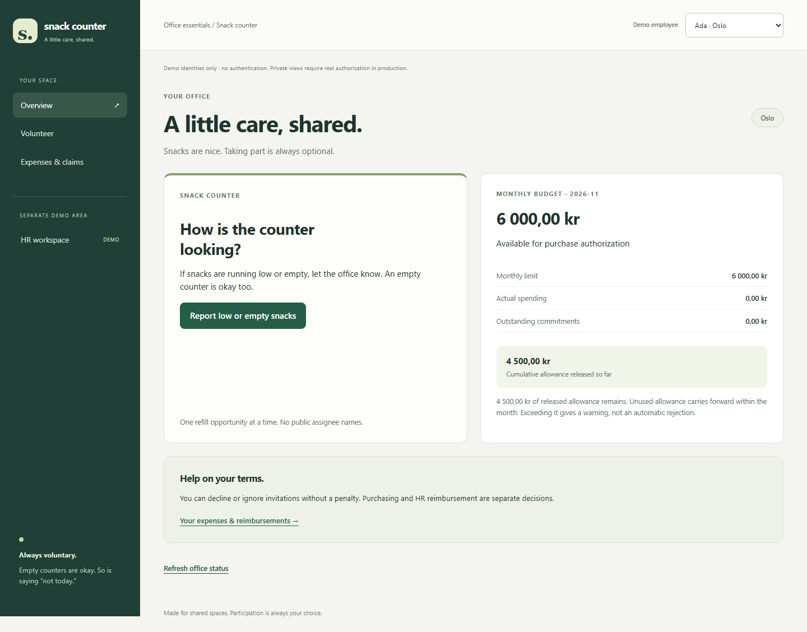

# Snack Counter Automation

A voluntary snack-refill coordinator for Oslo and Bengaluru. Employees sometimes buy office snacks with their own money and request reimbursement from an external HR system. This exercise makes refill commitments, office spending and reimbursement progress visible without making anyone responsible for keeping the counter stocked.

**An empty counter is acceptable. Invitations are optional. Declining or ignoring carries no penalty.**

## What is implemented

- One active refill opportunity per office, with database-enforced reservation exclusivity.
- Fair invitation selection, bounded reminders, pre-purchase expiry and explicit voluntary offers.
- Private assignment views; public refill status omits the volunteer's identity.
- Office monthly budgets: **6,000 NOK** in Oslo and **15,000 INR** in Bengaluru, configurable by office.
- Four cumulative allowance periods, soft spending advisories, purchase commitments and actual-expense reconciliation.
- Receipt-reference reimbursement claims, idempotent simulated HR submission, timeout reconciliation, and separate approval/payment states.
- Native-currency and consolidated reporting with a recorded simulated exchange rate.
- Contribution history and an HR-oriented leaderboard, independent of money spent.

## Stack and structure

Angular 22, TypeScript, standalone components, Router and HttpClient; .NET 10 / ASP.NET Core Minimal API; EF Core with SQLite; xUnit and Angular/Vitest tests. No additional server infrastructure is required.

```text
backend/SnackCounter.Api       HTTP routes, startup and background worker
backend/SnackCounter.Core      Lifecycle, budget, HR, reporting and persistence
backend/SnackCounter.Tests     SQLite-backed xUnit tests
frontend/snack-counter-ui     Angular application and frontend tests
docs/                         Design, architecture, tests and demonstration
scripts/                      Opt-in live verification and screenshot capture
SnackCounter.slnx             Backend solution
```

## Screenshots from the running application

The demonstration uses fictional seed employees and a disposable database. Priya reports the empty Bengaluru counter; Ravi reserves it, authorizes ₹1,000 and records ₹900 actual spending. His claim stays pending with HR.




See the [complete six-image gallery and repeatable demo](docs/DEMO.md), including accepted reservation, purchase commitment and HR spending/contribution records.

## How the workflows fit together

An empty/low report creates or returns the office's active opportunity. An invited volunteer accepts, or an eligible employee explicitly offers help. Before buying, the volunteer confirms an estimate: the backend validates ownership, the strict reservation deadline, currency and remaining monthly funds atomically. Actual completion replaces the estimate with actual spending. A purchasing task never automatically becomes available again; unresolved purchases retain their commitments in NeedsReview.

Reimbursement is a separate lifecycle. The purchaser creates a claim from the completed actual expense and supplies a receipt reference. Simulated HR submission can succeed, fail definitely, or have an uncertain result requiring lookup. Approval does not mean payment. Neither approval nor rejection changes the office's recorded expense.

## Run locally

Prerequisites: **.NET SDK 10** and **Node.js 24.15+ within Node 24**, with npm. All Angular tooling is installed locally.

From the repository root:

```sh
dotnet run --project backend/SnackCounter.Api --no-launch-profile --urls http://127.0.0.1:5187
```

In a second terminal:

```sh
cd frontend/snack-counter-ui
npm ci
npm start
```

Open **http://localhost:4200**. On Windows PowerShell with script execution disabled, use `npm.cmd` instead of `npm`. The development proxy forwards `/api` to port 5187, so no CORS setup is necessary. The API initializes SQLite and seeds six fictional employees across two offices.

Routes: `/dashboard`, `/volunteer`, `/expenses`, `/hr`. The employee selector simulates identity; it is **not authentication**. For an isolated demonstration that leaves ordinary development data untouched, use [docs/DEMO.md](docs/DEMO.md), which uses separate ports and a fresh temporary database. Configuration for budgets, invitation limits and simulated exchange rates is in [appsettings.json](backend/SnackCounter.Api/appsettings.json).

## Build and test

Stop the relevant development server before rebuilding/reinstalling if Windows reports locked files.

```sh
# Repository root
dotnet build SnackCounter.slnx
dotnet test SnackCounter.slnx

# Frontend directory
cd frontend/snack-counter-ui
npm ci
npm run build
npm test -- --watch=false
```

Latest verified: **66 backend + 29 frontend = 95 tests passed**, with both builds passing. See [test strategy and results](docs/test-cases.md). [GitHub Actions](.github/workflows/ci.yml) defines separate backend/frontend build-and-test jobs for pushes to `main` and pull requests targeting `main`; hosted execution is not claimed as verified.

## Simulation boundaries and limitations

- Chat notifications are private-addressed console messages through `IChat`, not an external chat service. Delivery is not durable.
- HR is a persistent local mock behind `IHrAdapter`. Decisions are explicit; approval/rejection requires at least one backend-clock day. Payment confirmation is separate. There is no background HR polling.
- Receipts are opaque references only; there are no image uploads. Use fictional references in the demo.
- Money uses integer minor units; SQLite decimal aggregation is avoided. INR/NOK are never summed directly. Authorization-month snapshots retain financial ownership; later reconciliation may change historical spending while the reporting exchange rate remains fixed.
- One counter per office is assumed. No budget/employee administration UI, deployment or cloud integration is provided.
- Employee and HR endpoints are not protected. Production would require authentication, employee ownership authorization, HR-specific permissions, protected receipt storage, durable integration recovery, managed schema migrations and operational monitoring.

## Documentation

- [Short design document](docs/design.md)
- [Workflow diagrams](docs/workflow.md)
- [Architecture and production evolution](docs/architecture.md)
- [Automated and live test cases](docs/test-cases.md)
- [AI assistance disclosure](docs/ai-assistance.md)
- [Demo, screenshots and safe reset](docs/DEMO.md)
- [Detailed Phase 2B contracts and semantics](PHASE2B.md)
- [Final integration review and currency investigation](INTEGRATION_REVIEW.md)
- [Frontend setup and integration notes](frontend/snack-counter-ui/README.md)
