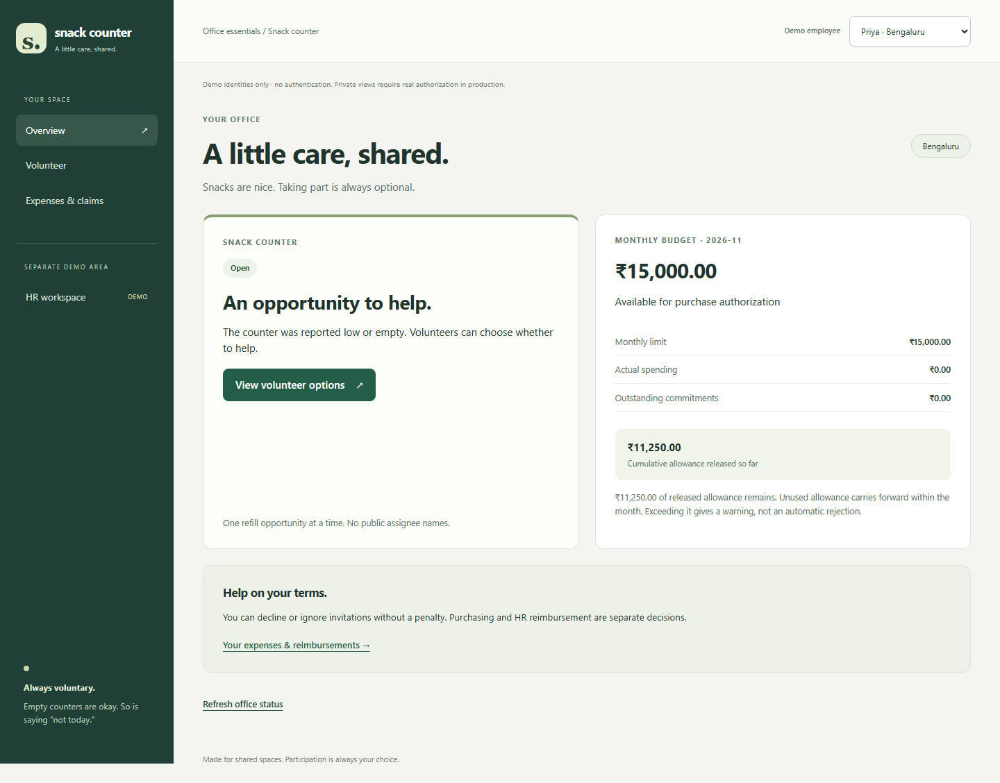
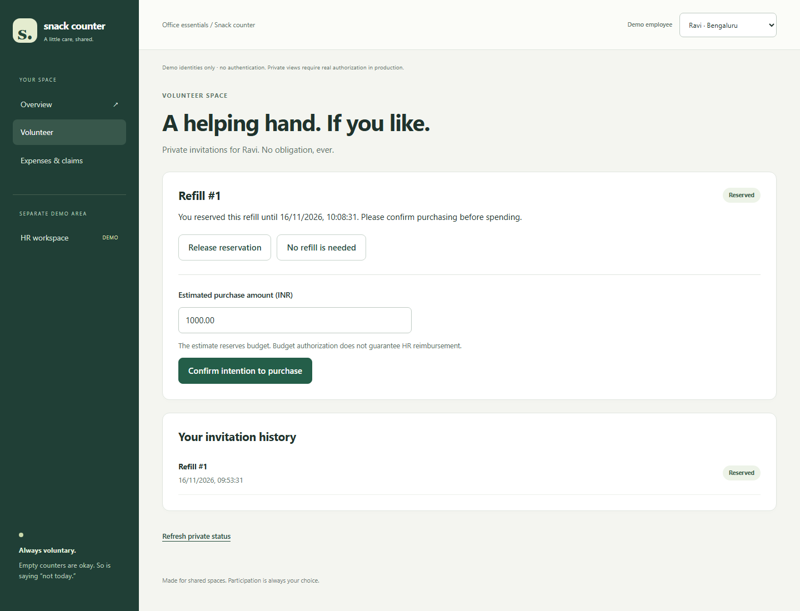
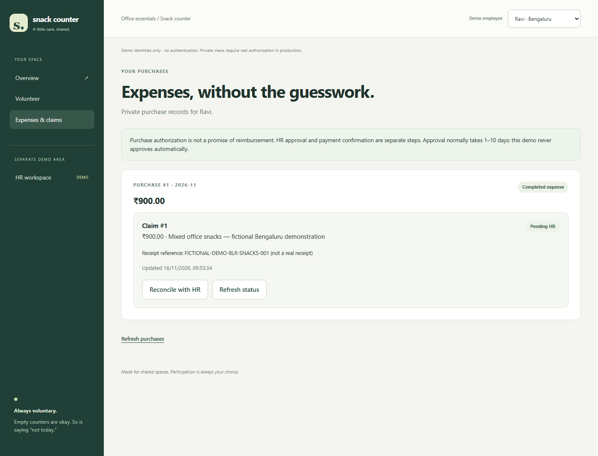
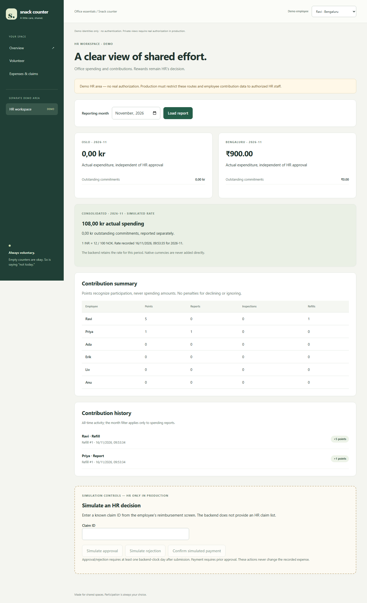

# Snack Counter Automation

A lightweight application for coordinating voluntary office snack refills, tracking spending, and supporting reimbursement and fair participation in Oslo and Bengaluru.

Office snack counters can stay empty when responsibility is unclear. Two people may buy snacks at once, while a small group of volunteers does most of the work. Reimbursement takes time, and management has little visibility into spending. This exercise makes commitments and costs visible without creating mandatory assignments.

## The core idea

**Automate coordination, not people's behavior.**

Employees are never required to refill snacks. Invitations are private, declining or ignoring has no penalty, and public refill status does not identify or blame the volunteer. The counter may remain empty. Contributions are recognized through a history and points summary; financial rewards remain HR's decision, not an automatic outcome.

## How it works

1. An employee reports an empty or low-stock counter.
2. The system creates one refill opportunity; repeated reports share it.
3. Eligible volunteers receive private invitations or explicitly offer to help.
4. One volunteer reserves the opportunity.
5. They check the counter, confirm no refill is needed, or authorize an estimated purchase before buying.
6. They record actual spending and can submit a reimbursement claim to simulated HR.
7. Office spending and contribution records become available for reporting.

A refill can be complete while reimbursement is still pending. See the [full lifecycle diagrams](docs/workflow.md).

## Tech stack

| Area | Technology |
| --- | --- |
| Frontend | Angular 22 and TypeScript; standalone components, Router and HttpClient |
| API | ASP.NET Core Minimal API on .NET 10 |
| Backend language | C# |
| Persistence | Entity Framework Core with SQLite |
| Automated tests | xUnit and Angular/Vitest tests |
| CI | GitHub Actions with separate backend and frontend jobs |
| Integrations | Simulated HR adapter and private-addressed chat console messages; no external services connected |

## Quick start

Install **.NET SDK 10** and **Node.js 24.15+ within Node 24**, with npm. No global Angular CLI is needed.

In Windows PowerShell, from the repository root:

```powershell
dotnet run --project backend/SnackCounter.Api --no-launch-profile --urls http://127.0.0.1:5187
```

In a second terminal, also starting at the repository root:

```powershell
cd frontend/snack-counter-ui
npm.cmd ci
npm.cmd start
```

Open **http://localhost:4200**. The development proxy forwards `/api` to port **5187**. On other shells, use `npm` instead of `npm.cmd`.

The API initializes local SQLite persistence and seeds six fictional employees. Select a demo employee, then explore Overview, Volunteer, Expenses or the separate HR workspace. These identities are not authentication. For a disposable database and repeatable walkthrough, follow the [demo guide](docs/DEMO.md). Additional setup details are in the [frontend README](frontend/snack-counter-ui/README.md).

## Screenshots

Actual application captures using fictional data: Priya reports the Bengaluru counter, Ravi authorizes ₹1,000, records ₹900, and submits a claim that remains pending.



<details>
<summary>View the reservation, reimbursement and HR reporting screens</summary>

**Accepted volunteer reservation**



**Reimbursement claim pending with simulated HR**



**Office spending and contribution records**



</details>

The [complete six-image gallery](docs/DEMO.md) also shows the purchase commitment and correctly formatted Oslo budget, with safe reset and repeatable capture instructions.

## Engineering highlights

### Concurrency-safe refill reservations

Two volunteers can accept simultaneously, even from different browsers. Transactions, conditional updates and database uniqueness constraints allow only one reservation to succeed. Disabling an Angular button prevents accidental repeat clicks; it cannot enforce concurrency across clients. [Architecture and correctness boundaries](docs/architecture.md).

### Reservation lifecycle and reassignment

Invitations expire, and a pre-purchase reservation can expire or be voluntarily released. Bounded replacement invitations respect a cooldown and notification cap. Confirmed Purchasing commitments never automatically reopen: the volunteer may already have spent money. Unresolved purchases retain their funds in NeedsReview. [Invitation and refill workflows](docs/workflow.md).

### Budget management

Oslo and Bengaluru have independent configurable monthly budgets of **6,000 NOK** and **15,000 INR**. The monthly authorization limit is hard; four cumulative spending allocations are soft advisories, with unused allowance carrying forward within the month. Outstanding estimates reduce availability, and actual expenses replace estimates without double-counting. Integer minor units preserve exact money values. Budget authorization does not guarantee HR reimbursement. [Design and budget trade-offs](docs/design.md).

### Reimbursement reliability

The persistent simulated HR system has a separate lifecycle and one logical claim per purchase. Submission uses a stable idempotency key; uncertain results require reconciliation rather than blind resubmission. Approval and payment remain separate events. These guarantees depend on equivalent idempotency or lookup support from a real provider. [Detailed HR contracts and simulation modes](PHASE2B.md).

### Multi-currency reporting

Local budgets and expenses remain in NOK or INR. Consolidated reports convert through an explicit exchange-rate snapshot retained for the reporting month; they never add NOK and INR directly. Actual spending remains visible regardless of reimbursement status. [Reporting architecture](docs/architecture.md).

### Fairness and recognition

Invitation selection prefers volunteers with fewer completed contributions, then considers invitation history. Declines and silence do not count as contributions or incur penalties. Unique report, inspection and refill events prevent repeat point awards; spending more does not earn more points. HR decides any rewards. [Voluntary participation design](docs/design.md).

## Automated tests

Latest reported **local validation results**, verified on 16 November 2026:

| Suite | Passed |
| --- | ---: |
| Backend | 66 |
| Frontend | 29 |
| **Total** | **95** |

Both builds also passed. These are local results, not a claim about current GitHub-hosted CI.

```powershell
# From the repository root
dotnet build SnackCounter.slnx
dotnet test SnackCounter.slnx

# Then run the frontend checks
cd frontend/snack-counter-ui
npm.cmd ci
npm.cmd run build
npm.cmd test -- --watch=false
```

SQLite-backed tests exercise concurrent acceptance, reservation expiry boundaries, budget exhaustion, purchase reconciliation, reimbursement idempotency, currency reporting and contribution deduplication. Frontend tests cover API contracts, exact money formatting and recovery from failed or stale requests. See [test cases and verification limits](docs/test-cases.md).

[GitHub Actions](.github/workflows/ci.yml) runs separate .NET 10 and Node 24 build-and-test jobs for pushes to `main` and pull requests targeting `main`. Stop the relevant dev server before reinstalling or rebuilding if Windows reports locked files.

## Documentation

| Document | Purpose |
| --- | --- |
| [Short design document](docs/design.md) | Business problems, decisions and trade-offs |
| [Workflow diagrams](docs/workflow.md) | Refill, invitation, budget and HR lifecycles |
| [Architecture](docs/architecture.md) | Components, persistence and possible production evolution |
| [Test cases](docs/test-cases.md) | Automated coverage and live verification |
| [Demo guide and screenshots](docs/DEMO.md) | Fictional scenario, isolated setup, capture and reset |
| [AI assistance disclosure](docs/ai-assistance.md) | Development chronology and review boundaries |
| [Phase 2B technical reference](PHASE2B.md) | HR endpoint bodies, submission modes and reporting semantics |
| [Final integration review](INTEGRATION_REVIEW.md) | Claim discovery, navigation and NOK formatting investigation |

## Trade-offs and limitations

This is an engineering exercise, not a production-ready company service. Employee and HR routes have no real authentication or authorization. HR and chat are simulations, and receipts are references rather than uploaded images. One counter per office is assumed.

SQLite keeps the exercise self-contained; this is not a proposed multi-instance production deployment. Real operation would need access controls, private data protection, managed migrations and durable integration recovery. Deployment is outside scope. Mandatory refill schedules, punishment mechanisms, automatic financial rewards and AI-driven spending predictions are deliberately excluded.

## AI-assisted development

ChatGPT/Codex assistance supported requirements exploration and design; Codex assisted implementation and testing. Human requirements and review questions shaped the voluntary-participation, privacy and financial boundaries. Automated tests and live demonstrations validated specific behaviors; AI output still requires human review and is not an independent correctness guarantee. See the [full disclosure](docs/ai-assistance.md).
