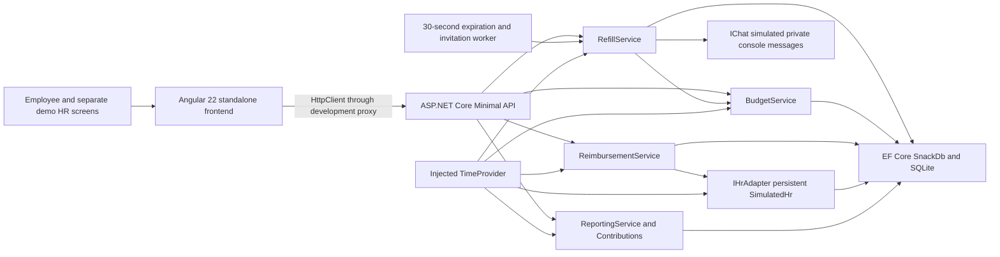

# Architecture

## Current implementation

### Responsibilities

| Component | Responsibility |
| --- | --- |
| Angular | Typed API access, demo identity selection, responsive routes, exact minor-unit display, loading/error/conflict feedback; no authority over concurrency |
| Minimal API | HTTP contracts, dependency wiring, configuration validation, known-schema initialization, demo HR controls and console logging |
| RefillService | Report deduplication, fair bounded invitations, acceptance, reservation release/expiry and unnecessary-refill completion |
| BudgetService | Atomic purchase authorization, monthly policy snapshots, soft allowance warnings, actual reconciliation, cancellation and overrun flags |
| ReimbursementService / IHrAdapter | One claim per purchase, persisted submission intent, stable key, safe retry/reconciliation and separate decision/payment states |
| ReportingService / Contributions | Native totals, snapshotted simulated rate, consolidated reporting and unique completion-based point events |
| ExpirationWorker | Sweep every 30 seconds, reopen expired pre-purchase reservations, retain uncertain financial commitments and offer Open work |
| SnackDb | Foreign keys, filtered unique indexes and persistent records; schema initialization/upgrades for this exercise |

### Data and correctness boundaries

SQLite stores offices, employees, requests, assignment attempts, monthly budgets, purchase commitments, reimbursement claims, mock HR records, contribution events and monthly reporting rates. Claims and provider records share the local database in this simulation, but provider submission occurs after local submission intent is persisted, outside that local state-update transaction.

Filtered indexes enforce one active request per office, one active reservation/purchase per request and one active attempt per employee/request. Claim-per-purchase and provider-key uniqueness protect reimbursements; contribution uniqueness protects point awards. SQLite write transactions and conditional updates make decisions authoritative across connections without an in-memory lock. The deadline is checked inside purchase authorization's SQL predicate. Under prolonged contention, lock timeouts can still surface; the UI handles failed requests but is not a database retry engine.

Money is stored as signed 64-bit integer minor units and aggregated as integers. Reconciled actuals replace outstanding estimates in reports, while authorization month and currency remain attached to the purchase. Exchange conversion uses decimal arithmetic after aggregation, with explicit rounding and period-specific rate metadata. The browser preserves unsafe JSON integers as strings and formats money with BigInt. The original receipt reference and description remain fixed when an existing draft is retrieved.

### Integration and privacy

The frontend development proxy strips `/api` and forwards to the backend; it adds no CORS or business rules. Public refill projections omit employee identity, while private demo endpoints filter by a supplied employee ID. These filters are not authentication. HR controls are visually separated, not protected.

`SimulatedChat` prints private-addressed optional messages; there is no external delivery service or durable notification outbox. `SimulatedHr` persists provider-side records and accepts explicit decisions. A real provider needs idempotency or reliable lookup to resolve uncertain submission safely. Receipt references are opaque strings, never fetched, and actual image uploads are absent.

## Possible production evolution — not implemented

Add employee authentication, ownership checks and HR roles before exposing these endpoints. Protect receipt/employee data and backups, introduce managed migrations, and add operational monitoring and appropriate contention/retry handling. Durable integration delivery/recovery and provider lookup contracts would be needed for real chat/HR. Hosting would need SPA route fallback and API routing; the development proxy is not a deployment configuration.

A server database could replace SQLite if workload requires it, after preserving and re-testing the current transaction/uniqueness invariants. None of this requires claiming a microservice, queue, cloud deployment or production security feature exists today. See [design trade-offs](design.md), [state diagrams](workflow.md) and [tests](test-cases.md).
