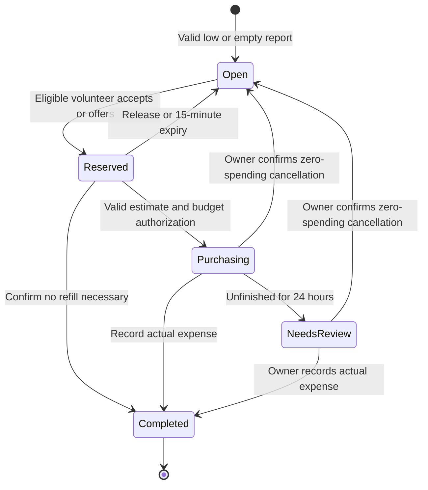
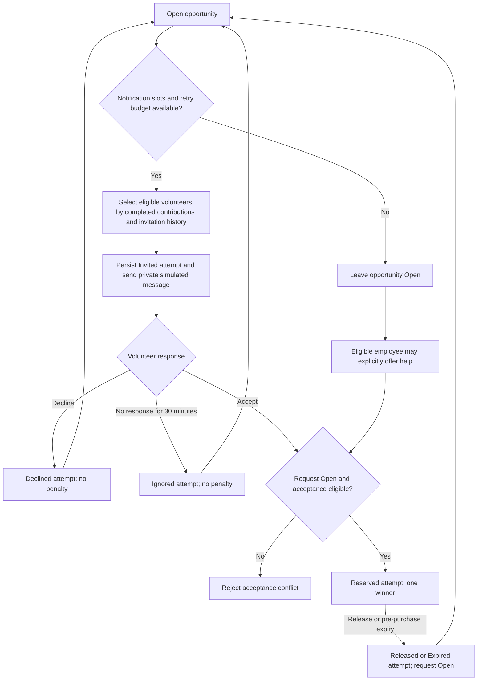
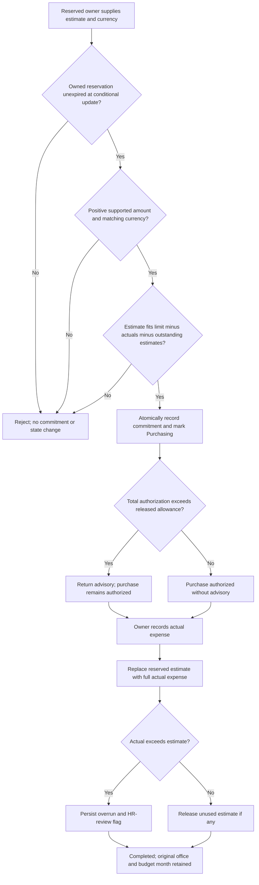
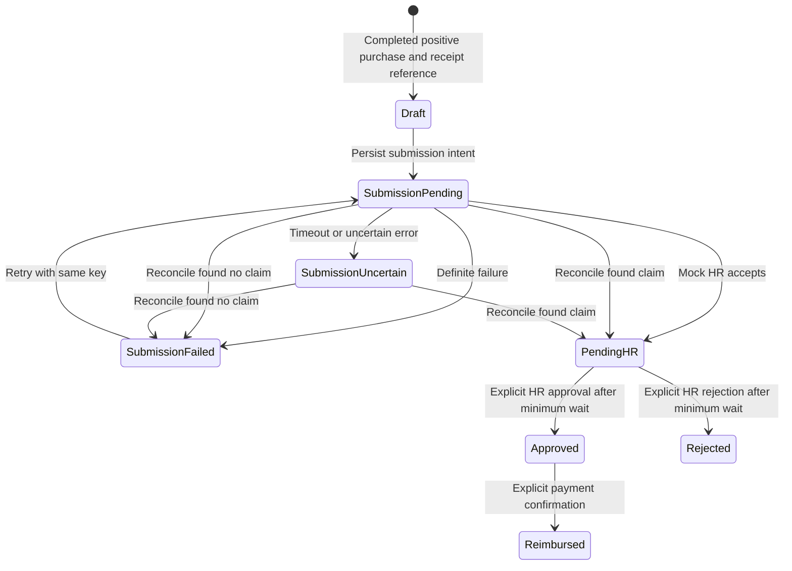

# Implemented workflows

These diagrams describe the current services; refill state, invitation attempts, financial commitments and HR claims are separate records.

## Refill opportunity

Repeated reports return the active opportunity. After completion, a subsequent report creates a **new** request. Purchasing/NeedsReview never reopen through automatic expiry; only explicit zero-spending cancellation releases the financial commitment.

## Invitations, consent and reassignment

The worker checks Open requests every 30 seconds; decline and reservation expiry also trigger replacement offers. There are normally at most two active invitations, a one-hour cooldown and six total notification attempts per refill; cooldown/cap are configurable. Explicit offers require no new notification and allow a previously declining/ignoring volunteer to return. Repeated notifications stop at the cap; the request may remain Open.

## Purchase authorization and reconciliation

Allowance periods are days 1–7, 8–14, 15–21 and 22 onward in the configured office timezone. A month change during authorization rejects with a retry message. Explicit cancellation with zero spending reopens the refill; ordinary pre-purchase release has no budget effect. Actual overruns may leave negative monthly availability: incurred spending is recorded rather than discarded.

## Reimbursement claim

Reconciliation copies the provider's current state, including Approved, Rejected or Reimbursed if it advanced externally. There is one logical claim per completed purchase and a unique provider key. Pending/uncertain submissions cannot blindly resubmit. Reads/discovery do not create claims or contact HR. Rejected claims are terminal; approval never implies payment. HR decisions never alter office spending. [Detailed contracts and simulation modes](../PHASE2B.md).
